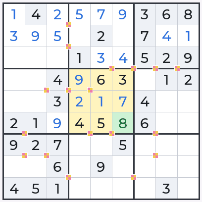

<!-- Written by tools/walkthrough.py battenburg: edit the script, not this page. -->
# Battenburg, step 18: the 8 in box 5

**Step 18 of 49** · [← Step 17](step-17.md) · [All steps](../battenburg.md#the-whole-puzzle-step-by-step) · [Step 19 →](step-19.md)

Box 5 needs an 8, and r6c6 is its last empty cell: **r6c6 = 8**.

**Step 18 of 49** · [← Step 17](step-17.md) · [All steps](../battenburg.md#the-whole-puzzle-step-by-step) · [Step 19 →](step-19.md)
