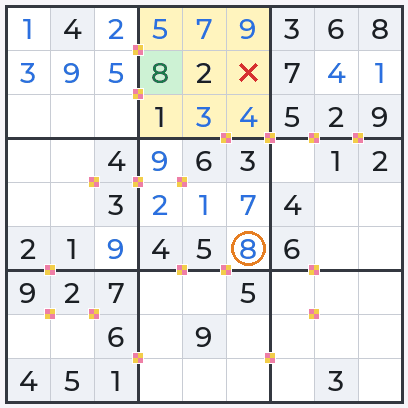

<!-- Written by tools/walkthrough.py battenburg: edit the script, not this page. -->
# Battenburg, step 19: the 8 in box 2

**Step 19 of 49** · [← Step 18](step-18.md) · [All steps](../battenburg.md#the-whole-puzzle-step-by-step) · [Step 20 →](step-20.md)

Box 2 needs an 8. r2c6: column 6 has one (r6c6). Only **r2c4** is left: **r2c4 = 8**.

**Step 19 of 49** · [← Step 18](step-18.md) · [All steps](../battenburg.md#the-whole-puzzle-step-by-step) · [Step 20 →](step-20.md)
