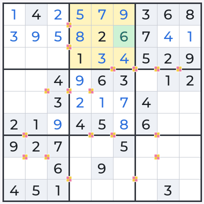

<!-- Written by tools/walkthrough.py battenburg: edit the script, not this page. -->
# Battenburg, step 20: the 6 in box 2

**Step 20 of 49** · [← Step 19](step-19.md) · [All steps](../battenburg.md#the-whole-puzzle-step-by-step) · [Step 21 →](step-21.md)

Box 2 needs a 6, and r2c6 is its last empty cell: **r2c6 = 6**.

**Step 20 of 49** · [← Step 19](step-19.md) · [All steps](../battenburg.md#the-whole-puzzle-step-by-step) · [Step 21 →](step-21.md)
