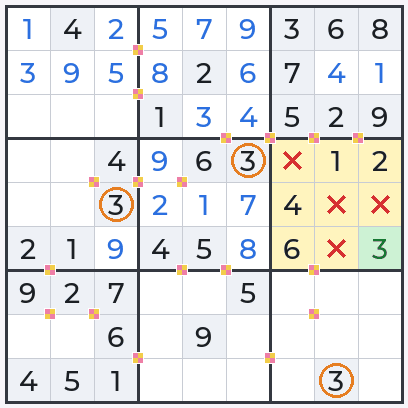

<!-- Written by tools/walkthrough.py battenburg: edit the script, not this page. -->
# Battenburg, step 21: the 3 in box 6

**Step 21 of 49** · [← Step 20](step-20.md) · [All steps](../battenburg.md#the-whole-puzzle-step-by-step) · [Step 22 →](step-22.md)

Box 6 needs a 3. r4c7: row 4 has one (r4c6). r5c8 and r5c9: row 5 has one (r5c3). r6c8: column 8 has one (r9c8). Only **r6c9** is left: **r6c9 = 3**.

**Step 21 of 49** · [← Step 20](step-20.md) · [All steps](../battenburg.md#the-whole-puzzle-step-by-step) · [Step 22 →](step-22.md)
