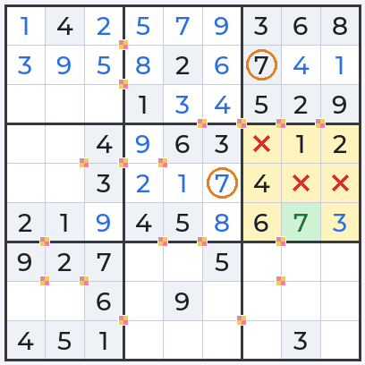

<!-- Written by tools/walkthrough.py battenburg: edit the script, not this page. -->
# Battenburg, step 22: the 7 in box 6

**Step 22 of 49** · [← Step 21](step-21.md) · [All steps](../battenburg.md#the-whole-puzzle-step-by-step) · [Step 23 →](step-23.md)

Box 6 needs a 7. r4c7: column 7 has one (r2c7). r5c8 and r5c9: row 5 has one (r5c6). Only **r6c8** is left: **r6c8 = 7**.

**Step 22 of 49** · [← Step 21](step-21.md) · [All steps](../battenburg.md#the-whole-puzzle-step-by-step) · [Step 23 →](step-23.md)
