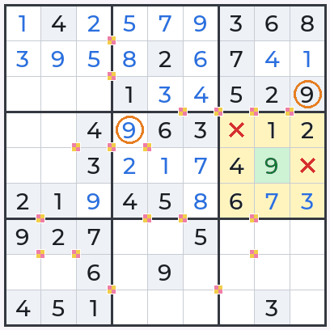

<!-- Written by tools/walkthrough.py battenburg: edit the script, not this page. -->
# Battenburg, step 23: the 9 in box 6

**Step 23 of 49** · [← Step 22](step-22.md) · [All steps](../battenburg.md#the-whole-puzzle-step-by-step) · [Step 24 →](step-24.md)

Box 6 needs a 9. r4c7: row 4 has one (r4c4). r5c9: column 9 has one (r3c9). Only **r5c8** is left: **r5c8 = 9**.

**Step 23 of 49** · [← Step 22](step-22.md) · [All steps](../battenburg.md#the-whole-puzzle-step-by-step) · [Step 24 →](step-24.md)
