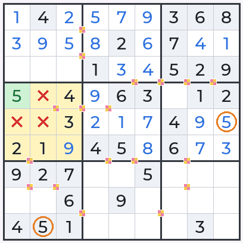

<!-- Written by tools/walkthrough.py battenburg: edit the script, not this page. -->
# Battenburg, step 25: the 5 in box 4

**Step 25 of 49** · [← Step 24](step-24.md) · [All steps](../battenburg.md#the-whole-puzzle-step-by-step) · [Step 26 →](step-26.md)

Box 4 needs a 5. r4c2: column 2 has one (r9c2). r5c1 and r5c2: row 5 has one (r5c9). Only **r4c1** is left: **r4c1 = 5**.

**Step 25 of 49** · [← Step 24](step-24.md) · [All steps](../battenburg.md#the-whole-puzzle-step-by-step) · [Step 26 →](step-26.md)
