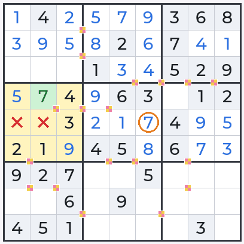

<!-- Written by tools/walkthrough.py battenburg: edit the script, not this page. -->
# Battenburg, step 26: the 7 in box 4

**Step 26 of 49** · [← Step 25](step-25.md) · [All steps](../battenburg.md#the-whole-puzzle-step-by-step) · [Step 27 →](step-27.md)

Box 4 needs a 7. r5c1 and r5c2: row 5 has one (r5c6). Only **r4c2** is left: **r4c2 = 7**.

**Step 26 of 49** · [← Step 25](step-25.md) · [All steps](../battenburg.md#the-whole-puzzle-step-by-step) · [Step 27 →](step-27.md)
