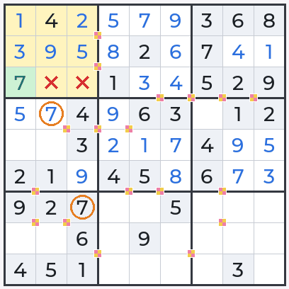

<!-- Written by tools/walkthrough.py battenburg: edit the script, not this page. -->
# Battenburg, step 27: the 7 in box 1

**Step 27 of 49** · [← Step 26](step-26.md) · [All steps](../battenburg.md#the-whole-puzzle-step-by-step) · [Step 28 →](step-28.md)

Box 1 needs a 7. r3c2: column 2 has one (r4c2). r3c3: column 3 has one (r7c3). Only **r3c1** is left: **r3c1 = 7**.

**Step 27 of 49** · [← Step 26](step-26.md) · [All steps](../battenburg.md#the-whole-puzzle-step-by-step) · [Step 28 →](step-28.md)
