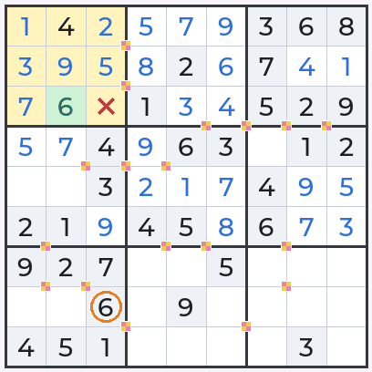

<!-- Written by tools/walkthrough.py battenburg: edit the script, not this page. -->
# Battenburg, step 28: the 6 in box 1

**Step 28 of 49** · [← Step 27](step-27.md) · [All steps](../battenburg.md#the-whole-puzzle-step-by-step) · [Step 29 →](step-29.md)

Box 1 needs a 6. r3c3: column 3 has one (r8c3). Only **r3c2** is left: **r3c2 = 6**.

**Step 28 of 49** · [← Step 27](step-27.md) · [All steps](../battenburg.md#the-whole-puzzle-step-by-step) · [Step 29 →](step-29.md)
