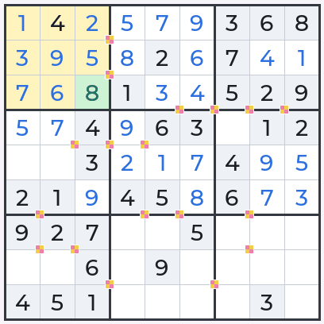

<!-- Written by tools/walkthrough.py battenburg: edit the script, not this page. -->
# Battenburg, step 29: the 8 in box 1

**Step 29 of 49** · [← Step 28](step-28.md) · [All steps](../battenburg.md#the-whole-puzzle-step-by-step) · [Step 30 →](step-30.md)

Box 1 needs an 8, and r3c3 is its last empty cell: **r3c3 = 8**.

**Step 29 of 49** · [← Step 28](step-28.md) · [All steps](../battenburg.md#the-whole-puzzle-step-by-step) · [Step 30 →](step-30.md)
