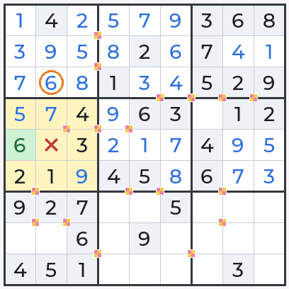

<!-- Written by tools/walkthrough.py battenburg: edit the script, not this page. -->
# Battenburg, step 30: the 6 in box 4

**Step 30 of 49** · [← Step 29](step-29.md) · [All steps](../battenburg.md#the-whole-puzzle-step-by-step) · [Step 31 →](step-31.md)

Box 4 needs a 6. r5c2: column 2 has one (r3c2). Only **r5c1** is left: **r5c1 = 6**.

**Step 30 of 49** · [← Step 29](step-29.md) · [All steps](../battenburg.md#the-whole-puzzle-step-by-step) · [Step 31 →](step-31.md)
