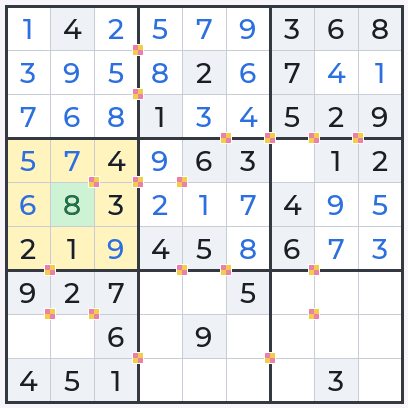

<!-- Written by tools/walkthrough.py battenburg: edit the script, not this page. -->
# Battenburg, step 31: the 8 in box 4

**Step 31 of 49** · [← Step 30](step-30.md) · [All steps](../battenburg.md#the-whole-puzzle-step-by-step) · [Step 32 →](step-32.md)

Box 4 needs an 8, and r5c2 is its last empty cell: **r5c2 = 8**.

**Step 31 of 49** · [← Step 30](step-30.md) · [All steps](../battenburg.md#the-whole-puzzle-step-by-step) · [Step 32 →](step-32.md)
