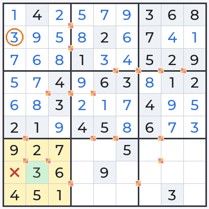

<!-- Written by tools/walkthrough.py battenburg: edit the script, not this page. -->
# Battenburg, step 33: the 3 in box 7

**Step 33 of 49** · [← Step 32](step-32.md) · [All steps](../battenburg.md#the-whole-puzzle-step-by-step) · [Step 34 →](step-34.md)

Box 7 needs a 3. r8c1: column 1 has one (r2c1). Only **r8c2** is left: **r8c2 = 3**.

**Step 33 of 49** · [← Step 32](step-32.md) · [All steps](../battenburg.md#the-whole-puzzle-step-by-step) · [Step 34 →](step-34.md)
