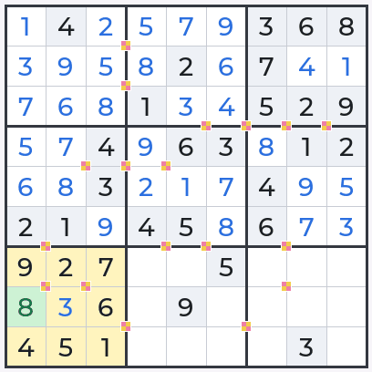

<!-- Written by tools/walkthrough.py battenburg: edit the script, not this page. -->
# Battenburg, step 34: the 8 in box 7

**Step 34 of 49** · [← Step 33](step-33.md) · [All steps](../battenburg.md#the-whole-puzzle-step-by-step) · [Step 35 →](step-35.md)

Box 7 needs an 8, and r8c1 is its last empty cell: **r8c1 = 8**.

**Step 34 of 49** · [← Step 33](step-33.md) · [All steps](../battenburg.md#the-whole-puzzle-step-by-step) · [Step 35 →](step-35.md)
