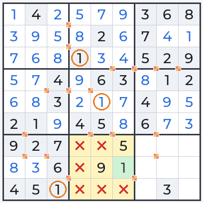

<!-- Written by tools/walkthrough.py battenburg: edit the script, not this page. -->
# Battenburg, step 35: the 1 in box 8

**Step 35 of 49** · [← Step 34](step-34.md) · [All steps](../battenburg.md#the-whole-puzzle-step-by-step) · [Step 36 →](step-36.md)

Box 8 needs a 1. r7c4 and r8c4: column 4 has one (r3c4). r7c5: column 5 has one (r5c5). r9c4, r9c5 and r9c6: row 9 has one (r9c3). Only **r8c6** is left: **r8c6 = 1**.

**Step 35 of 49** · [← Step 34](step-34.md) · [All steps](../battenburg.md#the-whole-puzzle-step-by-step) · [Step 36 →](step-36.md)
