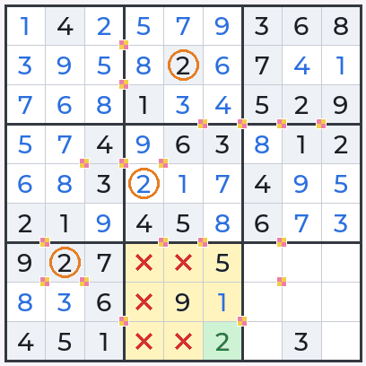

<!-- Written by tools/walkthrough.py battenburg: edit the script, not this page. -->
# Battenburg, step 36: the 2 in box 8

**Step 36 of 49** · [← Step 35](step-35.md) · [All steps](../battenburg.md#the-whole-puzzle-step-by-step) · [Step 37 →](step-37.md)

Box 8 needs a 2. r7c4 and r7c5: row 7 has one (r7c2). r8c4 and r9c4: column 4 has one (r5c4). r9c5: column 5 has one (r2c5). Only **r9c6** is left: **r9c6 = 2**.

**Step 36 of 49** · [← Step 35](step-35.md) · [All steps](../battenburg.md#the-whole-puzzle-step-by-step) · [Step 37 →](step-37.md)
