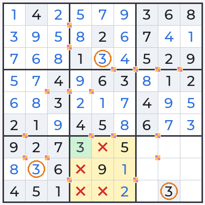

<!-- Written by tools/walkthrough.py battenburg: edit the script, not this page. -->
# Battenburg, step 37: the 3 in box 8

**Step 37 of 49** · [← Step 36](step-36.md) · [All steps](../battenburg.md#the-whole-puzzle-step-by-step) · [Step 38 →](step-38.md)

Box 8 needs a 3. r7c5: column 5 has one (r3c5). r8c4: row 8 has one (r8c2). r9c4 and r9c5: row 9 has one (r9c8). Only **r7c4** is left: **r7c4 = 3**.

**Step 37 of 49** · [← Step 36](step-36.md) · [All steps](../battenburg.md#the-whole-puzzle-step-by-step) · [Step 38 →](step-38.md)
