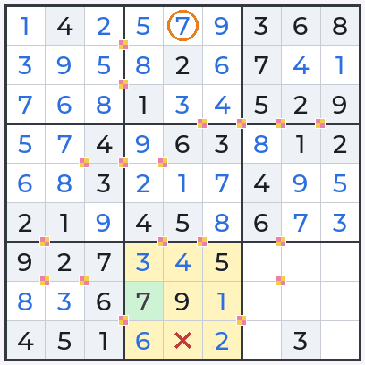

<!-- Written by tools/walkthrough.py battenburg: edit the script, not this page. -->
# Battenburg, step 40: the 7 in box 8

**Step 40 of 49** · [← Step 39](step-39.md) · [All steps](../battenburg.md#the-whole-puzzle-step-by-step) · [Step 41 →](step-41.md)

Box 8 needs a 7. r9c5: column 5 has one (r1c5). Only **r8c4** is left: **r8c4 = 7**.

**Step 40 of 49** · [← Step 39](step-39.md) · [All steps](../battenburg.md#the-whole-puzzle-step-by-step) · [Step 41 →](step-41.md)
