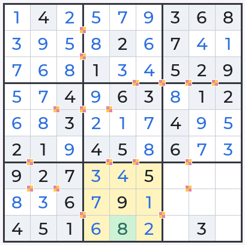

<!-- Written by tools/walkthrough.py battenburg: edit the script, not this page. -->
# Battenburg, step 41: the 8 in box 8

**Step 41 of 49** · [← Step 40](step-40.md) · [All steps](../battenburg.md#the-whole-puzzle-step-by-step) · [Step 42 →](step-42.md)

Box 8 needs an 8, and r9c5 is its last empty cell: **r9c5 = 8**.

**Step 41 of 49** · [← Step 40](step-40.md) · [All steps](../battenburg.md#the-whole-puzzle-step-by-step) · [Step 42 →](step-42.md)
