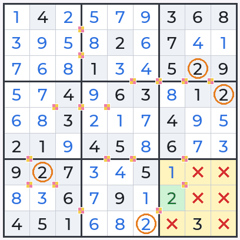

<!-- Written by tools/walkthrough.py battenburg: edit the script, not this page. -->
# Battenburg, step 43: the 2 in box 9

**Step 43 of 49** · [← Step 42](step-42.md) · [All steps](../battenburg.md#the-whole-puzzle-step-by-step) · [Step 44 →](step-44.md)

Box 9 needs a 2. r7c8 and r7c9: row 7 has one (r7c2). r8c8: column 8 has one (r3c8). r8c9: column 9 has one (r4c9). r9c7 and r9c9: row 9 has one (r9c6). Only **r8c7** is left: **r8c7 = 2**.

**Step 43 of 49** · [← Step 42](step-42.md) · [All steps](../battenburg.md#the-whole-puzzle-step-by-step) · [Step 44 →](step-44.md)
