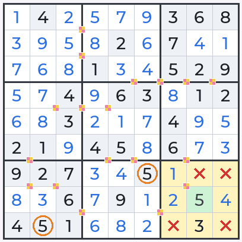

<!-- Written by tools/walkthrough.py battenburg: edit the script, not this page. -->
# Battenburg, step 45: the 5 in box 9

**Step 45 of 49** · [← Step 44](step-44.md) · [All steps](../battenburg.md#the-whole-puzzle-step-by-step) · [Step 46 →](step-46.md)

Box 9 needs a 5. r7c8 and r7c9: row 7 has one (r7c6). r9c7 and r9c9: row 9 has one (r9c2). Only **r8c8** is left: **r8c8 = 5**.

**Step 45 of 49** · [← Step 44](step-44.md) · [All steps](../battenburg.md#the-whole-puzzle-step-by-step) · [Step 46 →](step-46.md)
