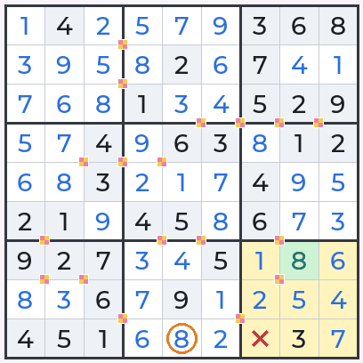

<!-- Written by tools/walkthrough.py battenburg: edit the script, not this page. -->
# Battenburg, step 48: the 8 in box 9

**Step 48 of 49** · [← Step 47](step-47.md) · [All steps](../battenburg.md#the-whole-puzzle-step-by-step) · [Step 49 →](step-49.md)

Box 9 needs an 8. r9c7: row 9 has one (r9c5). Only **r7c8** is left: **r7c8 = 8**.

**Step 48 of 49** · [← Step 47](step-47.md) · [All steps](../battenburg.md#the-whole-puzzle-step-by-step) · [Step 49 →](step-49.md)
