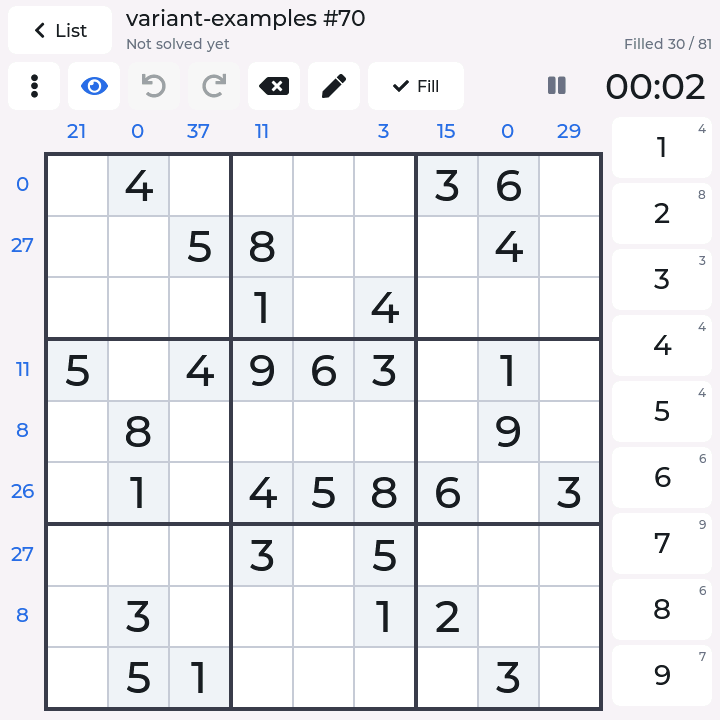
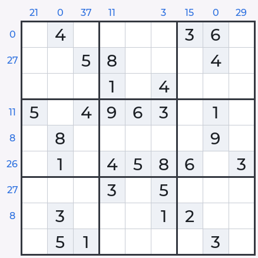

# Battlefield

[← All variants](README.md) · [Puzzles](../features-puzzles.md) · [How to play](../how-to-play.md)

## The rules

[Classic](classic.md) rules, and **clues outside the grid**, left of a row or above a column. Take the line's first digit, **X**, and its last, **Y**: they mark out the first X cells and the last Y cells. Where the two **overlap**, the clue is the sum of the overlapping cells; where they **don't**, it's the sum of the cells **between** them. A row 3 7 4 9 5 1 8 6 2 has X = 3 and Y = 2: 9 + 5 + 1 + 8 = 23 between them. The clue reads the same from either end, and a line without a clue says nothing.

## On the board

- The clues sit left of the rows and above the columns, like Before Nine's. A clue can be 0: the two parts just meet.
- A full overlap (or gap) that doesn't add up to its clue turns its row or column's digits red.
- The grader and hints know one step: once a line with a clue has 4 empty cells or fewer, every order of its missing digits is tried against the clue. "The clue of row 4 is 11: its first X and last Y cells (X, Y its end digits) overlap on that sum, or have it between them. The ways left leave row 4, column 2 7."
- **Puzzles → ⋮ → New puzzle → Clues → Battlefield**: three quarters of the lines have a clue (Hard and Expert: three fifths).

## How to solve it

- **X + Y says which.** Above 9 the parts overlap on X + Y − 9 cells; up to 9 they leave 9 − X − Y cells between them. A clue of **0** means X + Y = 9 exactly.
- **Count the cells.** A clue of 3 can't be four different digits, and a clue of 40 needs a long gap or overlap: so the end digits are far from free.
- **The ends matter most.** Try the end digits the row or column still allows: most pairs give a part too short or too long for the clue.
- **Either end.** The rule reads the same from both sides, so the clue's side doesn't matter.

## Worked example

**variant-examples #70**, Battlefield Easy (see [Classic](classic.md#worked-example-the-whole-puzzle) for how to import the examples; cells are written r*row*c*column*).

**Step 1: r4c2.** Row 4 reads 5, ., 4, 9, 6, 3, ., 1, . and its clue is **11**; column 2 has 4, 8, 1, 3 and 5. By the Classic rules r4c2 could be 2 or 7. With a 2 there, r4c7 and r4c9 take 7 and 8, so Y is 7 or 8 and X is 5: the parts overlap. With Y = 7 they overlap on 4, 9 and 6 (19); with Y = 8 on 2, 4, 9 and 6 (21). Neither is 11. **r4c2 = 7**.

**Step 2: row 1's ends.** Row 1's clue is **0**: its first X cells and last Y cells just meet, so X + Y = 9. Row 1 has 4, 3 and 6 already, which leaves 1 and 8 or 2 and 7 for r1c1 and r1c9, in either order. The rest of row 1 never holds those two.

With r4c2 = 7, row 4 reads 5, 7, 4, 9, 6, 3, ., 1, . and needs 2 and 8: an 8 last would make the parts overlap on 7, 4, 9 and 6 (26), so **r4c9 = 2** and **r4c7 = 8** (5 and 2 leave 3 + 8 = 11 between them).

## The whole puzzle, step by step

<!-- walkthrough -->
<!-- Written by tools/walkthrough.py battlefield: edit the script, not this part. -->

The whole puzzle, from the start to the last cell: 51 steps, each one a single (one place left for a digit, or one digit left for a cell), taken in the order a box's single comes first, so not quite the order of the worked example above. Each step has a page of its own, with **Previous** and **Next**: pick its number below. In each picture, the unit the step looks at is tinted yellow (for a cell with one digit left: its row, column and box), the new digit is on green, the digits that rule cells out have an **orange ring**, and the empty cells they rule out a **red cross**. Givens are on grey, digits from earlier steps in blue.

| [1](battlefield/step-01.md) | [2](battlefield/step-02.md) | [3](battlefield/step-03.md) | [4](battlefield/step-04.md) | [5](battlefield/step-05.md) | [6](battlefield/step-06.md) | [7](battlefield/step-07.md) | [8](battlefield/step-08.md) | [9](battlefield/step-09.md) | [10](battlefield/step-10.md) |
|:-:|:-:|:-:|:-:|:-:|:-:|:-:|:-:|:-:|:-:|
| [11](battlefield/step-11.md) | [12](battlefield/step-12.md) | [13](battlefield/step-13.md) | [14](battlefield/step-14.md) | [15](battlefield/step-15.md) | [16](battlefield/step-16.md) | [17](battlefield/step-17.md) | [18](battlefield/step-18.md) | [19](battlefield/step-19.md) | [20](battlefield/step-20.md) |
| [21](battlefield/step-21.md) | [22](battlefield/step-22.md) | [23](battlefield/step-23.md) | [24](battlefield/step-24.md) | [25](battlefield/step-25.md) | [26](battlefield/step-26.md) | [27](battlefield/step-27.md) | [28](battlefield/step-28.md) | [29](battlefield/step-29.md) | [30](battlefield/step-30.md) |
| [31](battlefield/step-31.md) | [32](battlefield/step-32.md) | [33](battlefield/step-33.md) | [34](battlefield/step-34.md) | [35](battlefield/step-35.md) | [36](battlefield/step-36.md) | [37](battlefield/step-37.md) | [38](battlefield/step-38.md) | [39](battlefield/step-39.md) | [40](battlefield/step-40.md) |
| [41](battlefield/step-41.md) | [42](battlefield/step-42.md) | [43](battlefield/step-43.md) | [44](battlefield/step-44.md) | [45](battlefield/step-45.md) | [46](battlefield/step-46.md) | [47](battlefield/step-47.md) | [48](battlefield/step-48.md) | [49](battlefield/step-49.md) | [50](battlefield/step-50.md) |
| [51](battlefield/step-51.md) |  |  |  |  |  |  |  |  |  |

Solved.

<!-- /walkthrough -->
