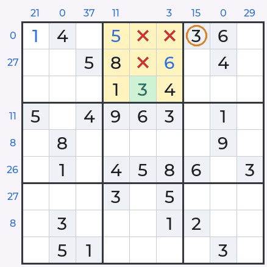

<!-- Written by tools/walkthrough.py battlefield: edit the script, not this page. -->
# Battlefield, step 4: the 3 in box 2

**Step 4 of 51** · [← Step 3](step-03.md) · [All steps](../battlefield.md#the-whole-puzzle-step-by-step) · [Step 5 →](step-05.md)

Box 2 needs a 3. r1c5 and r1c6: row 1 has one (r1c7). r2c5: with a 3 there, no first and last digits are left for row 2 whose overlap or gap could add up to its clue 27. Only **r3c5** is left: **r3c5 = 3**.

**Step 4 of 51** · [← Step 3](step-03.md) · [All steps](../battlefield.md#the-whole-puzzle-step-by-step) · [Step 5 →](step-05.md)
