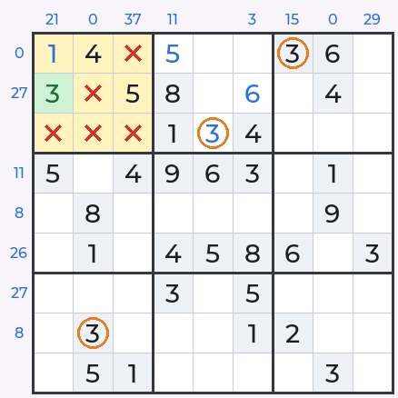

<!-- Written by tools/walkthrough.py battlefield: edit the script, not this page. -->
# Battlefield, step 5: the 3 in box 1

**Step 5 of 51** · [← Step 4](step-04.md) · [All steps](../battlefield.md#the-whole-puzzle-step-by-step) · [Step 6 →](step-06.md)

Box 1 needs a 3. r1c3: row 1 has one (r1c7). r2c2: column 2 has one (r8c2). r3c1, r3c2 and r3c3: row 3 has one (r3c5). Only **r2c1** is left: **r2c1 = 3**.

**Step 5 of 51** · [← Step 4](step-04.md) · [All steps](../battlefield.md#the-whole-puzzle-step-by-step) · [Step 6 →](step-06.md)
