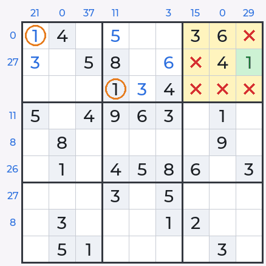

<!-- Written by tools/walkthrough.py battlefield: edit the script, not this page. -->
# Battlefield, step 6: the 1 in box 3

**Step 6 of 51** · [← Step 5](step-05.md) · [All steps](../battlefield.md#the-whole-puzzle-step-by-step) · [Step 7 →](step-07.md)

Box 3 needs a 1. r1c9: row 1 has one (r1c1). r3c7, r3c8 and r3c9: row 3 has one (r3c4). r2c7: with a 1 there, no first and last digits are left for row 2 whose overlap or gap could add up to its clue 27. Only **r2c9** is left: **r2c9 = 1**.

**Step 6 of 51** · [← Step 5](step-05.md) · [All steps](../battlefield.md#the-whole-puzzle-step-by-step) · [Step 7 →](step-07.md)
