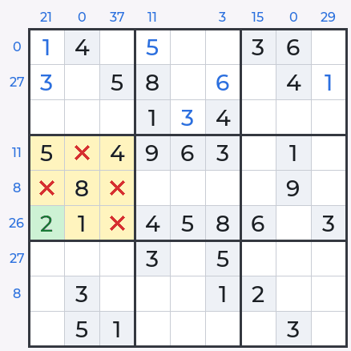

<!-- Written by tools/walkthrough.py battlefield: edit the script, not this page. -->
# Battlefield, step 7: the 2 in box 4

**Step 7 of 51** · [← Step 6](step-06.md) · [All steps](../battlefield.md#the-whole-puzzle-step-by-step) · [Step 8 →](step-08.md)

Box 4 needs a 2. r4c2: with a 2 there, no first and last digits are left for row 4 whose overlap or gap could add up to its clue 11. r5c1: with a 2 there, no first and last digits are left for column 1 whose overlap or gap could add up to its clue 21. r5c3: with a 2 there, no first and last digits are left for column 3 whose overlap or gap could add up to its clue 37. r6c3: with a 2 there, no first and last digits are left for row 6 whose overlap or gap could add up to its clue 26. Only **r6c1** is left: **r6c1 = 2**.

**Step 7 of 51** · [← Step 6](step-06.md) · [All steps](../battlefield.md#the-whole-puzzle-step-by-step) · [Step 8 →](step-08.md)
