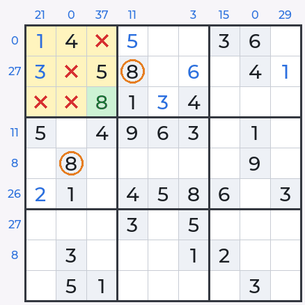

<!-- Written by tools/walkthrough.py battlefield: edit the script, not this page. -->
# Battlefield, step 8: the 8 in box 1

**Step 8 of 51** · [← Step 7](step-07.md) · [All steps](../battlefield.md#the-whole-puzzle-step-by-step) · [Step 9 →](step-09.md)

Box 1 needs an 8. r2c2: row 2 has one (r2c4). r3c2: column 2 has one (r5c2). r1c3: with an 8 there, no first and last digits are left for row 1 whose overlap or gap could add up to its clue 0. r3c1: with an 8 there, no first and last digits are left for column 1 whose overlap or gap could add up to its clue 21. Only **r3c3** is left: **r3c3 = 8**.

**Step 8 of 51** · [← Step 7](step-07.md) · [All steps](../battlefield.md#the-whole-puzzle-step-by-step) · [Step 9 →](step-09.md)
