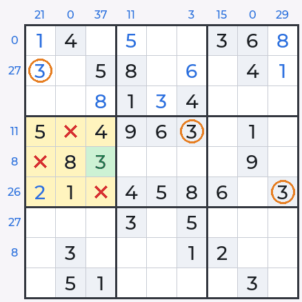

<!-- Written by tools/walkthrough.py battlefield: edit the script, not this page. -->
# Battlefield, step 10: the 3 in box 4

**Step 10 of 51** · [← Step 9](step-09.md) · [All steps](../battlefield.md#the-whole-puzzle-step-by-step) · [Step 11 →](step-11.md)

Box 4 needs a 3. r4c2: row 4 has one (r4c6). r5c1: column 1 has one (r2c1). r6c3: row 6 has one (r6c9). Only **r5c3** is left: **r5c3 = 3**.

**Step 10 of 51** · [← Step 9](step-09.md) · [All steps](../battlefield.md#the-whole-puzzle-step-by-step) · [Step 11 →](step-11.md)
