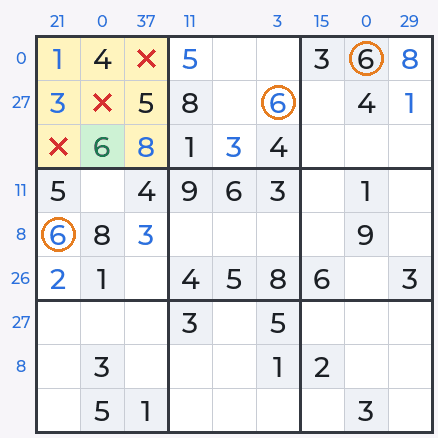

<!-- Written by tools/walkthrough.py battlefield: edit the script, not this page. -->
# Battlefield, step 12: the 6 in box 1

**Step 12 of 51** · [← Step 11](step-11.md) · [All steps](../battlefield.md#the-whole-puzzle-step-by-step) · [Step 13 →](step-13.md)

Box 1 needs a 6. r1c3: row 1 has one (r1c8). r2c2: row 2 has one (r2c6). r3c1: column 1 has one (r5c1). Only **r3c2** is left: **r3c2 = 6**.

**Step 12 of 51** · [← Step 11](step-11.md) · [All steps](../battlefield.md#the-whole-puzzle-step-by-step) · [Step 13 →](step-13.md)
