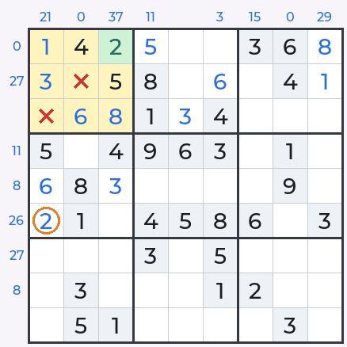

<!-- Written by tools/walkthrough.py battlefield: edit the script, not this page. -->
# Battlefield, step 13: the 2 in box 1

**Step 13 of 51** · [← Step 12](step-12.md) · [All steps](../battlefield.md#the-whole-puzzle-step-by-step) · [Step 14 →](step-14.md)

Box 1 needs a 2. r3c1: column 1 has one (r6c1). r2c2: with a 2 there, row 2 starts with 3 and ends with 1, and its gap can't add up to its clue 27. Only **r1c3** is left: **r1c3 = 2**.

**Step 13 of 51** · [← Step 12](step-12.md) · [All steps](../battlefield.md#the-whole-puzzle-step-by-step) · [Step 14 →](step-14.md)
