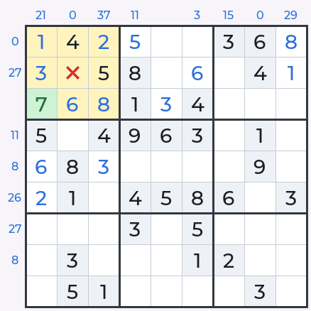

<!-- Written by tools/walkthrough.py battlefield: edit the script, not this page. -->
# Battlefield, step 14: the 7 in box 1

**Step 14 of 51** · [← Step 13](step-13.md) · [All steps](../battlefield.md#the-whole-puzzle-step-by-step) · [Step 15 →](step-15.md)

Box 1 needs a 7. r2c2: with a 7 there, row 2 starts with 3 and ends with 1, and its gap can't add up to its clue 27. Only **r3c1** is left: **r3c1 = 7**.

**Step 14 of 51** · [← Step 13](step-13.md) · [All steps](../battlefield.md#the-whole-puzzle-step-by-step) · [Step 15 →](step-15.md)
