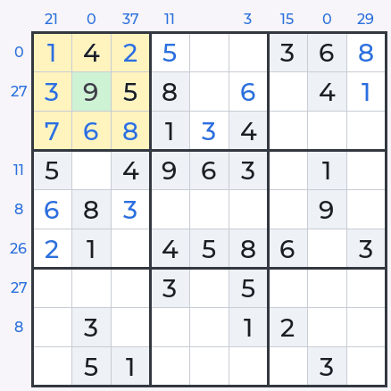

<!-- Written by tools/walkthrough.py battlefield: edit the script, not this page. -->
# Battlefield, step 15: the 9 in box 1

**Step 15 of 51** · [← Step 14](step-14.md) · [All steps](../battlefield.md#the-whole-puzzle-step-by-step) · [Step 16 →](step-16.md)

Box 1 needs a 9, and r2c2 is its last empty cell: **r2c2 = 9**.

**Step 15 of 51** · [← Step 14](step-14.md) · [All steps](../battlefield.md#the-whole-puzzle-step-by-step) · [Step 16 →](step-16.md)
