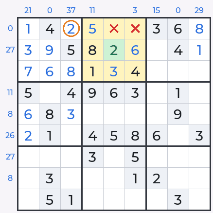

<!-- Written by tools/walkthrough.py battlefield: edit the script, not this page. -->
# Battlefield, step 16: the 2 in box 2

**Step 16 of 51** · [← Step 15](step-15.md) · [All steps](../battlefield.md#the-whole-puzzle-step-by-step) · [Step 17 →](step-17.md)

Box 2 needs a 2. r1c5 and r1c6: row 1 has one (r1c3). Only **r2c5** is left: **r2c5 = 2**.

**Step 16 of 51** · [← Step 15](step-15.md) · [All steps](../battlefield.md#the-whole-puzzle-step-by-step) · [Step 17 →](step-17.md)
