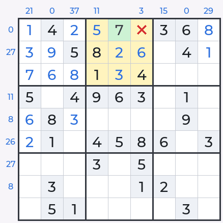

<!-- Written by tools/walkthrough.py battlefield: edit the script, not this page. -->
# Battlefield, step 17: the 7 in box 2

**Step 17 of 51** · [← Step 16](step-16.md) · [All steps](../battlefield.md#the-whole-puzzle-step-by-step) · [Step 18 →](step-18.md)

Box 2 needs a 7. r1c6: with a 7 there, no first and last digits are left for column 6 whose overlap or gap could add up to its clue 3. Only **r1c5** is left: **r1c5 = 7**.

**Step 17 of 51** · [← Step 16](step-16.md) · [All steps](../battlefield.md#the-whole-puzzle-step-by-step) · [Step 18 →](step-18.md)
