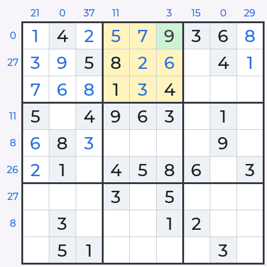

<!-- Written by tools/walkthrough.py battlefield: edit the script, not this page. -->
# Battlefield, step 18: the 9 in box 2

**Step 18 of 51** · [← Step 17](step-17.md) · [All steps](../battlefield.md#the-whole-puzzle-step-by-step) · [Step 19 →](step-19.md)

Box 2 needs a 9, and r1c6 is its last empty cell: **r1c6 = 9**.

**Step 18 of 51** · [← Step 17](step-17.md) · [All steps](../battlefield.md#the-whole-puzzle-step-by-step) · [Step 19 →](step-19.md)
