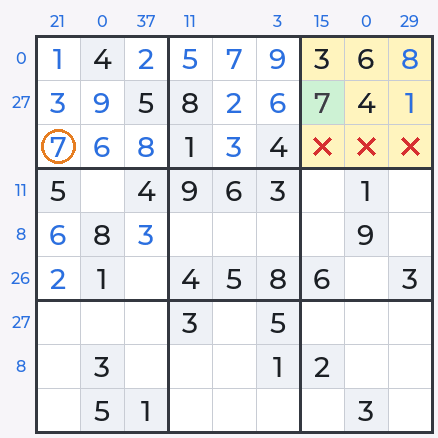

<!-- Written by tools/walkthrough.py battlefield: edit the script, not this page. -->
# Battlefield, step 19: the 7 in box 3

**Step 19 of 51** · [← Step 18](step-18.md) · [All steps](../battlefield.md#the-whole-puzzle-step-by-step) · [Step 20 →](step-20.md)

Box 3 needs a 7. r3c7, r3c8 and r3c9: row 3 has one (r3c1). Only **r2c7** is left: **r2c7 = 7**.

**Step 19 of 51** · [← Step 18](step-18.md) · [All steps](../battlefield.md#the-whole-puzzle-step-by-step) · [Step 20 →](step-20.md)
