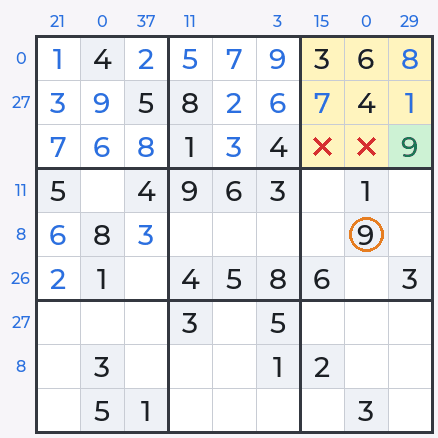

<!-- Written by tools/walkthrough.py battlefield: edit the script, not this page. -->
# Battlefield, step 20: the 9 in box 3

**Step 20 of 51** · [← Step 19](step-19.md) · [All steps](../battlefield.md#the-whole-puzzle-step-by-step) · [Step 21 →](step-21.md)

Box 3 needs a 9. r3c8: column 8 has one (r5c8). r3c7: with a 9 there, no first and last digits are left for column 7 whose overlap or gap could add up to its clue 15. Only **r3c9** is left: **r3c9 = 9**.

**Step 20 of 51** · [← Step 19](step-19.md) · [All steps](../battlefield.md#the-whole-puzzle-step-by-step) · [Step 21 →](step-21.md)
