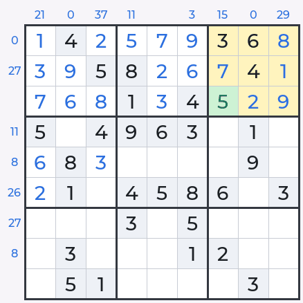

<!-- Written by tools/walkthrough.py battlefield: edit the script, not this page. -->
# Battlefield, step 22: the 5 in box 3

**Step 22 of 51** · [← Step 21](step-21.md) · [All steps](../battlefield.md#the-whole-puzzle-step-by-step) · [Step 23 →](step-23.md)

Box 3 needs a 5, and r3c7 is its last empty cell: **r3c7 = 5**.

**Step 22 of 51** · [← Step 21](step-21.md) · [All steps](../battlefield.md#the-whole-puzzle-step-by-step) · [Step 23 →](step-23.md)
