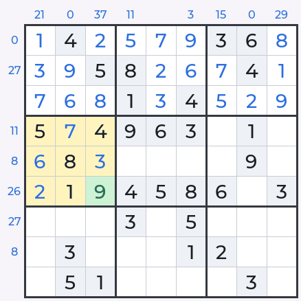

<!-- Written by tools/walkthrough.py battlefield: edit the script, not this page. -->
# Battlefield, step 24: the 9 in box 4

**Step 24 of 51** · [← Step 23](step-23.md) · [All steps](../battlefield.md#the-whole-puzzle-step-by-step) · [Step 25 →](step-25.md)

Box 4 needs a 9, and r6c3 is its last empty cell: **r6c3 = 9**.

**Step 24 of 51** · [← Step 23](step-23.md) · [All steps](../battlefield.md#the-whole-puzzle-step-by-step) · [Step 25 →](step-25.md)
