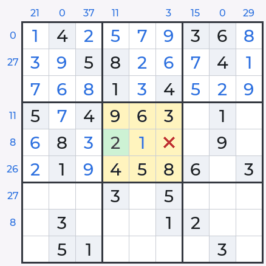

<!-- Written by tools/walkthrough.py battlefield: edit the script, not this page. -->
# Battlefield, step 26: the 2 in box 5

**Step 26 of 51** · [← Step 25](step-25.md) · [All steps](../battlefield.md#the-whole-puzzle-step-by-step) · [Step 27 →](step-27.md)

Box 5 needs a 2. r5c6: with a 2 there, no first and last digits are left for row 5 whose overlap or gap could add up to its clue 8. Only **r5c4** is left: **r5c4 = 2**.

**Step 26 of 51** · [← Step 25](step-25.md) · [All steps](../battlefield.md#the-whole-puzzle-step-by-step) · [Step 27 →](step-27.md)
