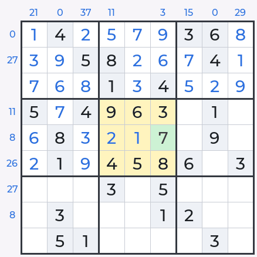

<!-- Written by tools/walkthrough.py battlefield: edit the script, not this page. -->
# Battlefield, step 27: the 7 in box 5

**Step 27 of 51** · [← Step 26](step-26.md) · [All steps](../battlefield.md#the-whole-puzzle-step-by-step) · [Step 28 →](step-28.md)

Box 5 needs a 7, and r5c6 is its last empty cell: **r5c6 = 7**.

**Step 27 of 51** · [← Step 26](step-26.md) · [All steps](../battlefield.md#the-whole-puzzle-step-by-step) · [Step 28 →](step-28.md)
