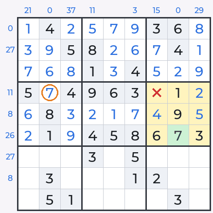

<!-- Written by tools/walkthrough.py battlefield: edit the script, not this page. -->
# Battlefield, step 31: the 7 in box 6

**Step 31 of 51** · [← Step 30](step-30.md) · [All steps](../battlefield.md#the-whole-puzzle-step-by-step) · [Step 32 →](step-32.md)

Box 6 needs a 7. r4c7: row 4 has one (r4c2). Only **r6c8** is left: **r6c8 = 7**.

**Step 31 of 51** · [← Step 30](step-30.md) · [All steps](../battlefield.md#the-whole-puzzle-step-by-step) · [Step 32 →](step-32.md)
