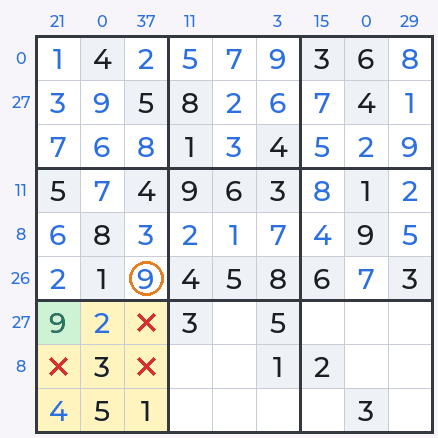

<!-- Written by tools/walkthrough.py battlefield: edit the script, not this page. -->
# Battlefield, step 35: the 9 in box 7

**Step 35 of 51** · [← Step 34](step-34.md) · [All steps](../battlefield.md#the-whole-puzzle-step-by-step) · [Step 36 →](step-36.md)

Box 7 needs a 9. r7c3 and r8c3: column 3 has one (r6c3). r8c1: with a 9 there, no first and last digits are left for row 8 whose overlap or gap could add up to its clue 8. Only **r7c1** is left: **r7c1 = 9**.

**Step 35 of 51** · [← Step 34](step-34.md) · [All steps](../battlefield.md#the-whole-puzzle-step-by-step) · [Step 36 →](step-36.md)
