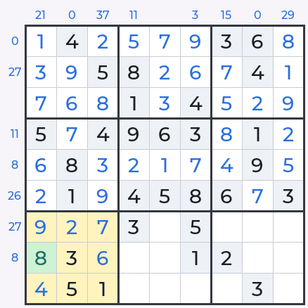

<!-- Written by tools/walkthrough.py battlefield: edit the script, not this page. -->
# Battlefield, step 38: the 8 in box 7

**Step 38 of 51** · [← Step 37](step-37.md) · [All steps](../battlefield.md#the-whole-puzzle-step-by-step) · [Step 39 →](step-39.md)

Box 7 needs an 8, and r8c1 is its last empty cell: **r8c1 = 8**.

**Step 38 of 51** · [← Step 37](step-37.md) · [All steps](../battlefield.md#the-whole-puzzle-step-by-step) · [Step 39 →](step-39.md)
