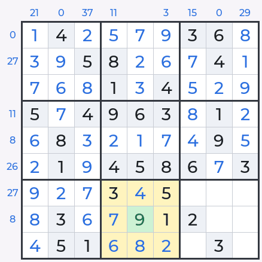

<!-- Written by tools/walkthrough.py battlefield: edit the script, not this page. -->
# Battlefield, step 44: the 9 in box 8

**Step 44 of 51** · [← Step 43](step-43.md) · [All steps](../battlefield.md#the-whole-puzzle-step-by-step) · [Step 45 →](step-45.md)

Box 8 needs a 9, and r8c5 is its last empty cell: **r8c5 = 9**.

**Step 44 of 51** · [← Step 43](step-43.md) · [All steps](../battlefield.md#the-whole-puzzle-step-by-step) · [Step 45 →](step-45.md)
