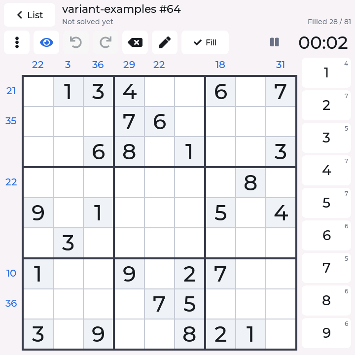
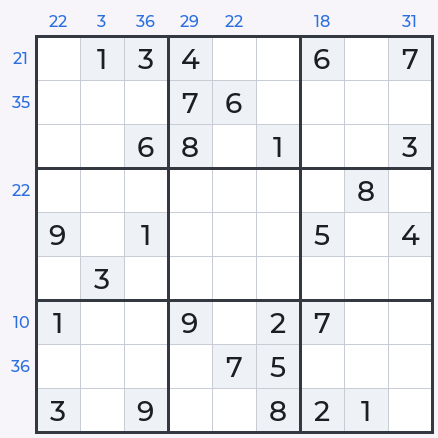

# Before Nine

[← All variants](README.md) · [Puzzles](../features-puzzles.md) · [How to play](../how-to-play.md)

## The rules

[Classic](classic.md) rules, and **clues outside the grid**: a number left of a row or above a column is **the sum of the digits between it and the 9** of that row or column, not counting the 9. A row reading 3 5 2 9 1 … from its clue has the clue 10. A line without a clue says nothing (its 9 may even be first).

## On the board

- The clues sit left of the rows and above the columns, like Sum Skyscrapers' and X-Sums'.
- When the digits from a clue up to its 9 are all filled in and don't add up to it, or the digits before a 9 already add up to more, they turn red.
- The grader and hints know one step: once a line with a clue has 4 empty cells or fewer, every order of its missing digits is tried against the clue. "The clue of column 7 is 18: the digits from there up to the 9 add up to it. Of the ways its empty cells can be filled, only those leave row 3, column 7 …" and the digits left.
- **Puzzles → ⋮ → New puzzle → Clues → Before Nine**: three quarters of the lines have a clue (Hard and Expert: three fifths).

## How to solve it

- **A clue puts its 9 within reach.** The digits before the 9 are all different and not 9: a clue of 3 puts the 9 at most third (1 + 2), a clue of 36 makes it last.
- **Add up from the edge.** Where the digits already placed from the clue add up to it exactly, the 9 is in the next cell; where they add up to more, the 9 is before them.
- **No 9 first.** A clue means something comes before the 9, so the cell next to a clue is never 9.
- **What a 9 would leave.** For each empty cell, ask what the cells before it would need to add up to if the 9 were there: often no different digits can make it.

## Worked example

**variant-examples #64**, Before Nine Easy (see [Classic](classic.md#worked-example-the-whole-puzzle) for how to import the examples; cells are written r*row*c*column*). Column 7's clue matters most here: **18**. Column 7 reads, from the top, 6, ., ., ., 5, ., 7, ., 2.

**Step 1: r3c7.** Row 3 has 6, 8, 1 and 3; column 7 has 6, 5, 7 and 2. By the Classic rules r3c7 could be 4 or 9. A 9 there would leave the digits before it as the 6 and one more digit, 14 at most: not 18. **r3c7 = 4**.

**Step 2: r6c7.** By the Classic rules it could be 1 or 9 (row 6 has 3, box 6 has 8). A 9 there would need r2c7 and r4c7 to add up to 18 − 6 − 4 − 5 = 3, so 1 and 2, but column 7 has its 2 already (r9c7). **r6c7 = 1**.

**Step 3: r2c7.** Row 2 has 7 and 6, box 3 has 3, so it could be 8 or 9; a 9 there would follow only the 6. **r2c7 = 8**.

Now 6 + 8 + 4 = 18 from the top of column 7: the 9 comes right after, in r4c7, and the column's last empty cell, r8c7, is 3.

## The whole puzzle, step by step

<!-- walkthrough -->
<!-- Written by tools/walkthrough.py before-nine: edit the script, not this part. -->

The whole puzzle, from the start to the last cell: 53 steps, each one a single (one place left for a digit, or one digit left for a cell), taken in the order a box's single comes first, so not quite the order of the worked example above. Each step has a page of its own, with **Previous** and **Next**: pick its number below. In each picture, the unit the step looks at is tinted yellow (for a cell with one digit left: its row, column and box), the new digit is on green, the digits that rule cells out have an **orange ring**, and the empty cells they rule out a **red cross**. Givens are on grey, digits from earlier steps in blue.

| [1](before-nine/step-01.md) | [2](before-nine/step-02.md) | [3](before-nine/step-03.md) | [4](before-nine/step-04.md) | [5](before-nine/step-05.md) | [6](before-nine/step-06.md) | [7](before-nine/step-07.md) | [8](before-nine/step-08.md) | [9](before-nine/step-09.md) | [10](before-nine/step-10.md) |
|:-:|:-:|:-:|:-:|:-:|:-:|:-:|:-:|:-:|:-:|
| [11](before-nine/step-11.md) | [12](before-nine/step-12.md) | [13](before-nine/step-13.md) | [14](before-nine/step-14.md) | [15](before-nine/step-15.md) | [16](before-nine/step-16.md) | [17](before-nine/step-17.md) | [18](before-nine/step-18.md) | [19](before-nine/step-19.md) | [20](before-nine/step-20.md) |
| [21](before-nine/step-21.md) | [22](before-nine/step-22.md) | [23](before-nine/step-23.md) | [24](before-nine/step-24.md) | [25](before-nine/step-25.md) | [26](before-nine/step-26.md) | [27](before-nine/step-27.md) | [28](before-nine/step-28.md) | [29](before-nine/step-29.md) | [30](before-nine/step-30.md) |
| [31](before-nine/step-31.md) | [32](before-nine/step-32.md) | [33](before-nine/step-33.md) | [34](before-nine/step-34.md) | [35](before-nine/step-35.md) | [36](before-nine/step-36.md) | [37](before-nine/step-37.md) | [38](before-nine/step-38.md) | [39](before-nine/step-39.md) | [40](before-nine/step-40.md) |
| [41](before-nine/step-41.md) | [42](before-nine/step-42.md) | [43](before-nine/step-43.md) | [44](before-nine/step-44.md) | [45](before-nine/step-45.md) | [46](before-nine/step-46.md) | [47](before-nine/step-47.md) | [48](before-nine/step-48.md) | [49](before-nine/step-49.md) | [50](before-nine/step-50.md) |
| [51](before-nine/step-51.md) | [52](before-nine/step-52.md) | [53](before-nine/step-53.md) |  |  |  |  |  |  |  |

Solved.

<!-- /walkthrough -->
