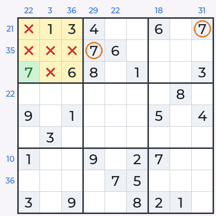

<!-- Written by tools/walkthrough.py before-nine: edit the script, not this page. -->
# Before Nine, step 1: the 7 in box 1

**Step 1 of 53** · [← The start](../before-nine.md#the-whole-puzzle-step-by-step) · [All steps](../before-nine.md#the-whole-puzzle-step-by-step) · [Step 2 →](step-02.md)

Box 1 needs a 7. r1c1: row 1 has one (r1c9). r2c1, r2c2 and r2c3: row 2 has one (r2c4). r3c2: from the top of column 2, a 7 there leaves no way for the digits before the 9 to add up to its clue 3. Only **r3c1** is left: **r3c1 = 7**.

**Step 1 of 53** · [← The start](../before-nine.md#the-whole-puzzle-step-by-step) · [All steps](../before-nine.md#the-whole-puzzle-step-by-step) · [Step 2 →](step-02.md)
