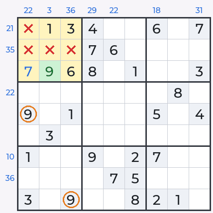

<!-- Written by tools/walkthrough.py before-nine: edit the script, not this page. -->
# Before Nine, step 2: the 9 in box 1

**Step 2 of 53** · [← Step 1](step-01.md) · [All steps](../before-nine.md#the-whole-puzzle-step-by-step) · [Step 3 →](step-03.md)

Box 1 needs a 9. r1c1 and r2c1: column 1 has one (r5c1). r2c3: column 3 has one (r9c3). r2c2: from the left of row 2, a 9 there leaves no way for the digits before the 9 to add up to its clue 35. Only **r3c2** is left: **r3c2 = 9**.

**Step 2 of 53** · [← Step 1](step-01.md) · [All steps](../before-nine.md#the-whole-puzzle-step-by-step) · [Step 3 →](step-03.md)
